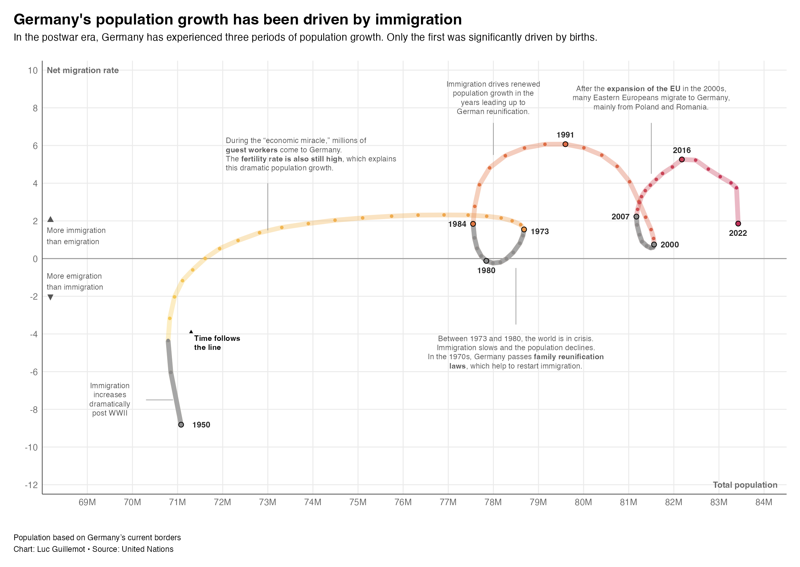

# Germany's Population and Migration: A Data Visualisation Recreation

**R | ggplot2 | Data Visualisation | Data Storytelling**

## 1. Overview

This project focuses on recreating an editorial-style data visualisation illustrating the relationship between Germany's population development and net migration over time.

The original visualisation was created by Luc Guillemot using data from the United Nations. The objective of this project was to reproduce its design using R and ggplot2, while practising more advanced data visualisation and storytelling techniques.

Rather than conducting an independent statistical analysis, this project focuses on visual communication: presenting historical data in an informative and visually engaging way.

## Original Visualisation and Attribution

This project is a recreation of a connected scatterplot originally created by **Luc Guillemot** and published in the Datawrapper Blog on January 18, 2024.

**Original article:** [Connecting the dots of population growth in Germany](https://www.datawrapper.de/blog/germany-population-connected-scatterplot)

The original visualisation explores the relationship between Germany's population development and net migration over time.

I recreated the chart using R and ggplot2, adapting the original visual design and annotations into a reproducible R workflow.

**Attribution:** Original visualisation and historical narrative by Luc Guillemot, Datawrapper Blog (2024).

**Licence:** The original Datawrapper blog content is licensed under [CC BY-SA 4.0](https://creativecommons.org/licenses/by-sa/4.0/). This recreated and adapted visualisation is shared under the same licence. Changes were made to the implementation and presentation.

## Data Source

The data used in the original visualisation comes from:

**United Nations, Department of Economic and Social Affairs, Population Division (2022). World Population Prospects 2022.**

[United Nations World Population Prospects](https://population.un.org/wpp/)

The dataset contains historical observations of Germany's population and net migration rate.

## 3. Tools and Technologies

The project was developed using:

- **R** – data preparation and visualisation.
- **ggplot2** – construction of the visualisation.
- **dplyr** – data manipulation and transformation.
- **ggtext** – formatted text annotations.
- **Quarto** – project documentation and report generation.

## 4. Data Preparation

The dataset contains historical observations of Germany's population and net migration rate.

The preparation process included:

- Renaming variables for easier reference.
- Converting variables to numeric format.
- Removing observations with missing years.
- Sorting observations chronologically.
- Converting population values into millions where necessary.

## 5. Visualisation Techniques

The chart combines several ggplot2 layers and custom design elements.

The main techniques used include:

- **Layered visualisation:** combining paths, points, text and annotations.
- **Colour gradients:** using a continuous yellow-to-pink gradient to represent the progression of time.
- **Historical highlighting:** displaying selected periods in grey to create visual contrast.
- **Custom annotations:** adding historical context directly to the chart.
- **Manual label positioning:** adjusting the placement of selected year labels to minimise overlap.
- **Theme customisation:** modifying axis formatting, typography, spacing and chart margins.

## 6. Final Visualisation

The recreated chart combines population development and net migration data, highlighting selected historical periods through colour gradients, annotations and highlighted observations.



*Recreated using R and ggplot2. Original visualisation by Luc Guillemot.*

## 7. Repository Structure

```text
germany-migration-visualisation/
│
├── germany-migration-visualisation.Rproj
├── README.md
├── germany_migration.qmd
├── germany_migration.html
│
├── data/
│   └── germany_migration_data.RData
│
└── figures/
    └── germany_migration.png
```

## 8. Reproducing the Project

To reproduce the visualisation:

**Requirements:**
- R
- RStudio
- Quarto

**Required R packages:**

```r
install.packages(c(
  "ggplot2",
  "dplyr",
  "ggtext",
  "here"
))
```

**Instructions:**

1. Clone or download this repository.
2. Open `germany-migration-visualisation.Rproj` in RStudio.
3. Install the required R packages.
4. Open `germany_migration.qmd`.
5. Click **Render** in RStudio to generate the HTML report.

The project uses relative file paths to locate the dataset within the repository.

## 9. Learning Outcomes

This project provided an opportunity to practise more advanced ggplot2 techniques and explore how visual design can improve data communication.

In particular, it helped develop skills in layered chart construction, custom annotations, continuous colour scales, manual label positioning and detailed theme customisation.

One of the main challenges was balancing a large amount of visual information while maintaining readability and creating a clear visual narrative.

